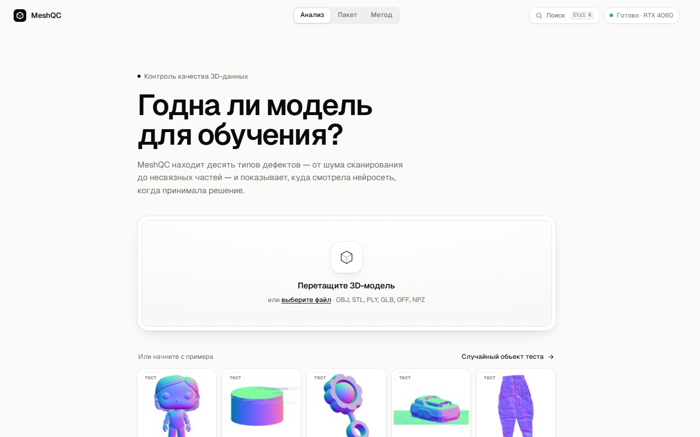
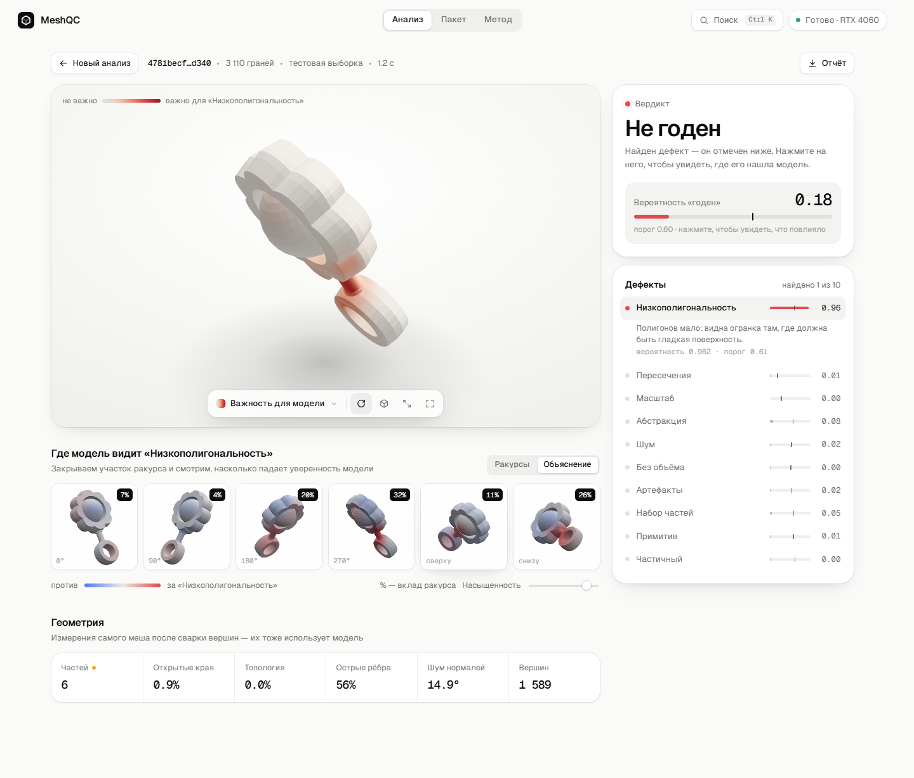
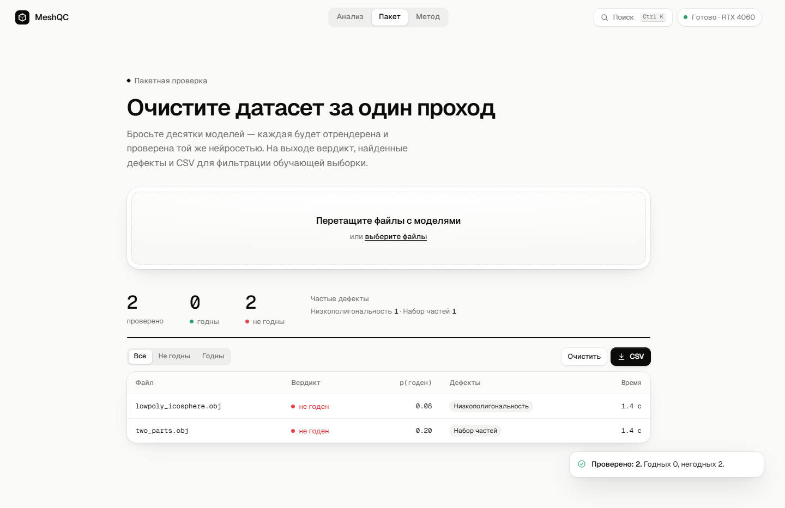

# MeshQC — контроль качества 3D-данных · Sber AI Challenge 2026

**1 место в основном этапе, финалист.** Задача конкурса — по 3D-модели найти 10 типов дефектов и решить,
годится ли объект для обучения генеративных нейросетей.

> Код, веса и данные конкурса будут опубликованы после защиты финала (ноябрь 2026).
> Сейчас здесь — описание задачи, подхода и продукта.

## Задача

Генератор 3D-моделей учится на том, что ему дали: мусор на входе — мусор на выходе.
По каждому мешу нужно предсказать 10 дефектов (низкополигональность, шум, пересечения, масштаб, абстракция,
«без объёма», артефакты, набор частей, примитив, частичный объект) и общий вердикт «годен / не годен».

- **Данные:** 43 тыс. объектов с массовой «шумной» ручной разметкой.
- **Метрика:** 10 × F1 по классу «годен» + 10 × взвешенный F1 по дефектам, максимум 20.

## Подход

- **Две точки зрения на объект.** Зрение — ансамбль трёх дообученных нейросетей DINOv2 (PyTorch) на рендерах
  карт нормалей с шести ракурсов. Геометрия — LightGBM на признаках самого меша (части, открытые края,
  топология, острые рёбра, шум нормалей).
- **Работа с шумной разметкой.** Измерили, насколько и в какую сторону ошибаются разметчики, и проверили,
  помогает ли чистка меток. Не помогает: тест размечен так же, поэтому модель учит манеру разметки,
  а не «истину».
- **Честная валидация.** Кросс-валидация с подбором порогов внутри фолда. Правила отбора моделей в ансамбль
  записывались до эксперимента, а не подгонялись под результат.
- **Инженерия данных.** Меши читаются по смещениям прямо из несжатого архива на 127 ГБ, без полной распаковки.
  Вершины «супа треугольников» свариваются перед расчётом геометрии.

## Продукт: веб-приложение MeshQC

Модель упакована в веб-приложение (FastAPI, three.js):

- вердикт по любому 3D-файлу (OBJ, STL, PLY, GLB, OFF) за 2–3 секунды;
- объяснение решения: тепловая карта на модели и вклад каждого ракурса (тест с закрытием участков);
- автоисправление типовых дефектов;
- пакетная проверка датасета с выгрузкой результатов в CSV.

## Стек

`Python` · `PyTorch` · `DINOv2` · `LightGBM` · `trimesh` · `FastAPI` · `three.js`

---

Автор: Кирилл Кореньков · [github.com/kirakorenkov](https://github.com/kirakorenkov)
